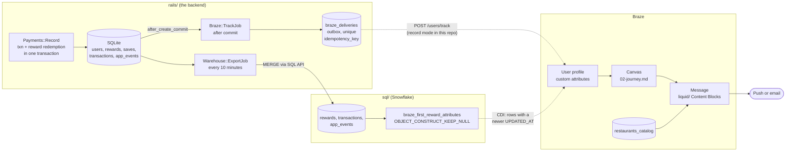
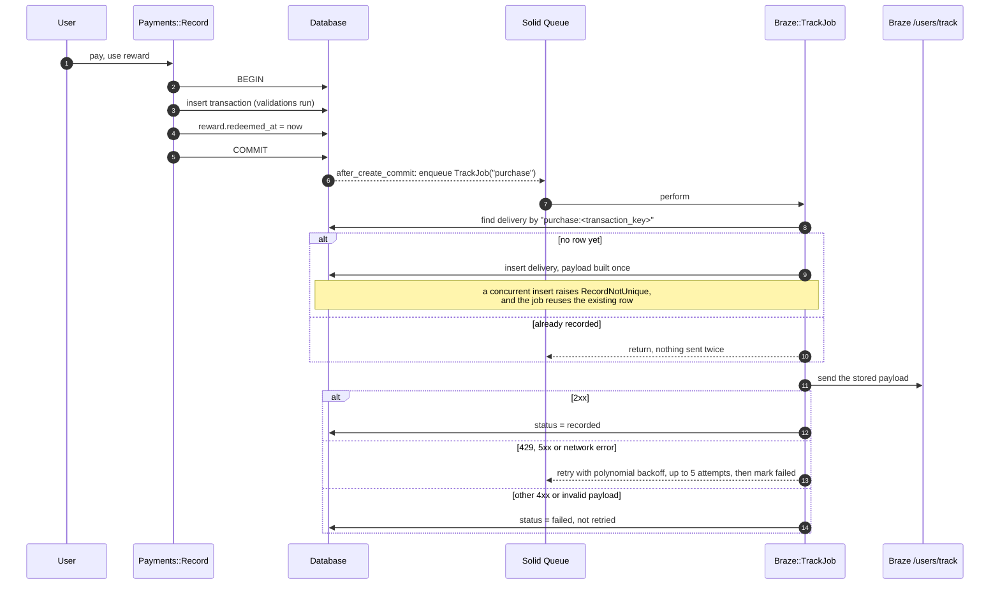
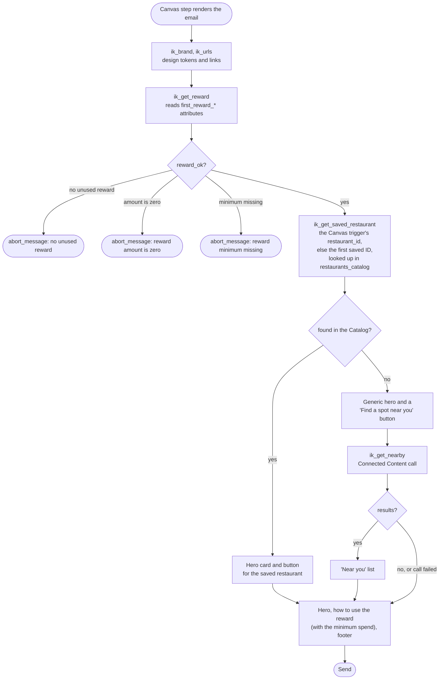
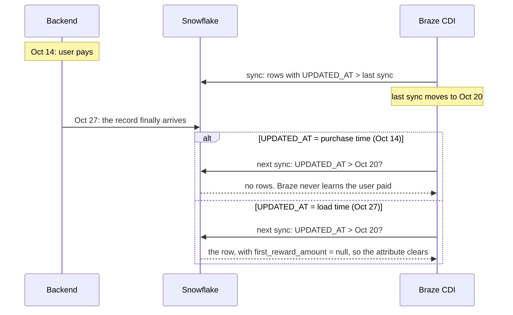
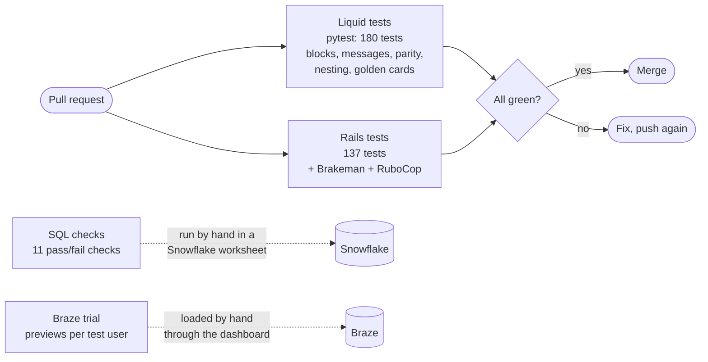

# Architecture

How the pieces of this repo fit together, in five diagrams. Each section links to the file that holds the detail. The Rails app has its own, deeper design doc in [`rails/ARCHITECTURE.md`](./rails/ARCHITECTURE.md).

Everything here is a sketch built from public documentation. All users, restaurants, and amounts are made up. Not affiliated with inKind.

---

## 1. The whole system

Two paths reach Braze. Events that start or end the journey go in real time through `/users/track`. Values computed in the warehouse go through Cloud Data Ingestion (CDI), which only reads rows with a newer `UPDATED_AT`.

| Part | Where | Detail |
|---|---|---|
| Data contract | [`01-data-contract.md`](./01-data-contract.md) | Every field, its type, and which path it takes |
| Journey | [`02-journey.md`](./02-journey.md) | Entry, filters, timing, exits, the control group |
| Message | [`liquid/`](./liquid/) | 17 Content Blocks and the messages built from them |
| Warehouse | [`sql/`](./sql/) | Sample data, the CDI view, audience checks, 11 pass/fail checks |
| Backend | [`rails/`](./rails/) | The outbox, the export, and a console to drive both |

---

## 2. A payment, end to end

The payment and the reward redemption commit together or not at all. Braze hears about the payment only after the commit, through an outbox row that makes every retry safe.

Code: [`rails/app/services/payments/record.rb`](./rails/app/services/payments/record.rb), [`rails/app/jobs/braze/track_job.rb`](./rails/app/jobs/braze/track_job.rb), [`rails/app/lib/braze/client.rb`](./rails/app/lib/braze/client.rb). The trial workspace has no REST API, so the client runs in record mode: it stores the exact request instead of sending it.

---

## 3. How the message decides what to say

The message checks the reward before anything else and stops itself when there's nothing true to promote. The abort sits in the message, not in a Content Block, so anyone reading the message sees the stop.

Code: [`liquid/messages/first_reward.email.liquid`](./liquid/messages/first_reward.email.liquid) and [`liquid/blocks/logic/`](./liquid/blocks/logic/). The push uses the same logic blocks, and a parity test checks that both make the same offer.

---

## 4. Why `UPDATED_AT` is the load time

CDI only picks up rows whose `UPDATED_AT` is newer than its last sync. If `UPDATED_AT` were the purchase time, a record that reached the warehouse late would be skipped for good. Check 11 in [`sql/03_checks.sql`](./sql/03_checks.sql) shows the bug on purpose, and the export stamps `UPDATED_AT` with the load time in UTC.

The same thing happens with a record that's only an hour late, if a sync runs in that hour.

---

## 5. What checks run, and where

The Liquid and Rails suites run in GitHub Actions on every pull request ([`.github/workflows/`](./.github/workflows/)). The SQL checks need a Snowflake account, so they run in a worksheet, not in CI. [`04-qa-and-measurement.md`](./04-qa-and-measurement.md) has the pre-launch checks a real send would add.
