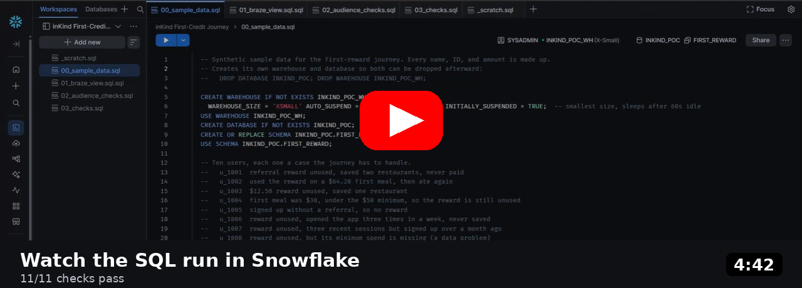
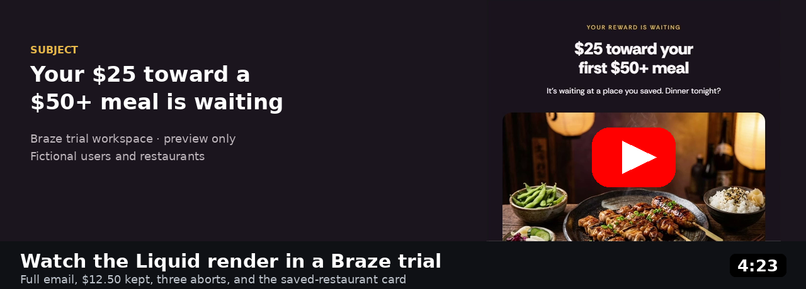
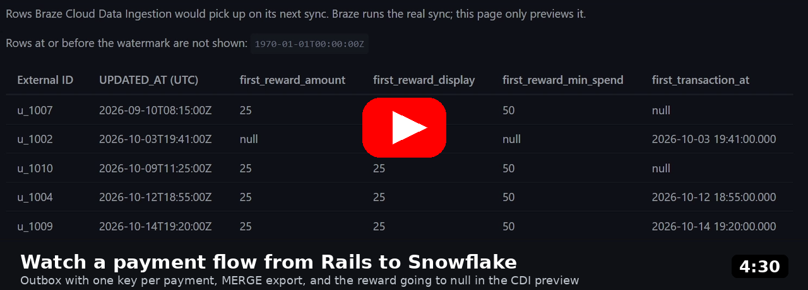

# Spectator to Diner: First-Reward Journey

Implementation sketch · Aaron Davis · October–November 2026

How I'd build one Braze journey end to end: get browse intent and the referral reward onto the profile, then send a pre-dinner nudge to referred users who haven't made a first purchase.

**[Case study](https://arndvs.com/projects/inkind-first-reward-journey)** · **[Full write-up](https://arndvs.com/blog/inkind-first-reward-journey)** · Fictional data, not affiliated with inKind

**Why this one:** I signed up for inKind through a referral, with $25 toward my first $50+ meal, and saved a restaurant or two. Two weeks later my wife and I spent a Saturday night on Google Maps deciding where to order, and inKind never came to mind. The two emails I'd received were general brand messages; neither mentioned my $25 or the places I'd saved, though everything that message needed was already in my account.

---

## What it does

- **Starts on a save.** Saving a restaurant enters the user into a Braze Canvas. The message goes out at 4:30 PM local time, with one follow-up three days later if the reward is still unused.
- **Holds back a control group.** 10% of entrants get nothing, so the journey can be measured against doing nothing. A second Canvas covers new users who browse without saving.
- **Stops itself when the data is wrong.** The Liquid checks the reward before anything renders and calls `abort_message` when it's missing, zero, or has no minimum spend. The optional nearby-restaurants lookup falls back quietly instead of failing the send.
- **Clears the reward when it's used.** A Rails app saves the payment and the reward change in one transaction, then queues the Braze event through an outbox, so a retry never sends it twice.
- **Keeps each field with one owner.** Events that start or end the journey go to Braze in real time through `/users/track`. Values computed in Snowflake go through Cloud Data Ingestion, which only syncs rows with a newer `UPDATED_AT`.

## Results

- **184 Liquid tests** and **146 Rails tests** pass in CI, plus Brakeman and RuboCop. Liquid tests include parity between the push and the email.
- **11 of 11 SQL checks** pass in a clean Snowflake account.
- **Braze trial previews matched the tests**, including all three abort cases.
- **No live results.** Nothing here has sent a real message. The planned measure is first-reward use within 14 days, compared with the control group.

## Walkthroughs

1. **The SQL running in Snowflake** (4:42). Synthetic users, the view Braze would read, 11/11 checks passing.

   [](https://youtu.be/OnmBVC8vrwE)

2. **The Liquid rendering in a Braze trial** (4:23). The full email, $12.50 kept, three aborts, and the saved-restaurant card. Preview only, nothing sent.

   [](https://youtu.be/fSDLiHyoBgs)

3. **A payment flowing from Rails to Snowflake** (4:30). A payment recorded once in the outbox, exported with a MERGE, and the reward going to null in the Cloud Data Ingestion preview. Record mode, nothing sent to Braze.

   [](https://youtu.be/ZBk5Az8jVrs)

## What the Braze trial taught me

Loading the setup into a trial workspace by hand turned up limits the docs don't make obvious:

- **CSV import can't set arrays**, so `saved_restaurants` has to arrive through `/users/track` or the warehouse sync.
- **Connected Content is blocked in a trial**, even inside a Liquid comment. The nearby lookup was loaded as a stub, and the Explore fallback is what shows.
- **The preference center tag fails** unless the named preference center already exists.
- **`:retry` aborts the message after five failed attempts**, so the optional nearby call doesn't use it. Retry only what the message can't do without.
- **The trial caps Content Blocks**, so the 17 blocks were cut to 8 for the trial.

Details in [`liquid/README.md`](./liquid/README.md#braze-trial-results).

## How it was built

In about a week, with AI agents drafting and tests deciding what shipped. Each change started as a ticket and a failing test, ran through CI, and got my review before merging. An independent audit pass found issues that I checked by hand; five were real and are fixed. The steps for one change, from gap to merge, are in [`docs/change-log.md`](./docs/change-log.md).

---

## What's built here

| File | What it contains |
|---|---|
| [`ARCHITECTURE.md`](./ARCHITECTURE.md) | How the pieces fit together, in five diagrams: the whole system, a payment end to end, how the message decides what to say, why `UPDATED_AT` is the load time, and which checks run where |
| [`01-data-contract.md`](./01-data-contract.md) | The profile fields, two sync paths (real-time `/users/track` for events, Snowflake Cloud Data Ingestion for computed attributes), sample payloads, the sync view, sync rules |
| [`02-journey.md`](./02-journey.md) | Audience rules, audience SQL, the Canvas flow, and a second Canvas for new users who browse without saving |
| [`03-message.liquid`](./03-message.liquid) | The template: saved-restaurant personalization from a Catalog, a Connected Content call for nearby picks with its own fallback, and an abort when there's no unused reward |
| [`04-qa-and-measurement.md`](./04-qa-and-measurement.md) | Pre-launch send-safety and rendering checks, how I'd ship the backend change, metrics by cohort, what I'd confirm first |
| [`sql/`](./sql/) | A runnable proof of concept: synthetic sample data, the Cloud Data Ingestion view, both audience checks, and pass/fail checks to run in a Snowflake worksheet |
| [`liquid/`](./liquid/) | `03` split into reusable Braze Content Blocks: design tokens, shared logic for push and email, then elements, components, and sections. Includes a component gallery and render tests for the QA cases |
| [`rails/`](./rails/) | The backend half of the data contract. It builds the `/users/track` events in `01` once per action (recorded, not sent), exports rows to Snowflake with their load time, and previews what Cloud Data Ingestion would sync |
| [`docs/`](./docs/README.md) | How the journey is designed, the current spec, decisions made and still open, and the gap register |

With only a few minutes, start with the "Who can receive it" checks in [`04-qa-and-measurement.md`](./04-qa-and-measurement.md). They decide who can get a message before anything sends.

## Running the checks

```bash
# Liquid: blocks, messages, push/email parity
cd liquid && pip install -r requirements.txt && python -m pytest tests -q

# Rails: tests, RuboCop, Brakeman (the same script CI runs)
cd rails && bin/ci
```

The SQL checks run in a Snowflake worksheet: `sql/00` to `sql/03`, in order. Setup notes, environments, and last recorded results are in [`docs/verification.md`](./docs/verification.md).

## What I'd do next

- A send log in Snowflake, so every send and abort can be counted
- Frequency caps across this journey and others
- Live sends through the REST API instead of record mode
- The measured comparison against the control group
- An experiment loop where agents propose and set up variants, and a person approves each one

---

## Conventions

- **Every event, attribute, table, endpoint, and threshold name is illustrative**, to be mapped to inKind's existing schema. I don't have access to inKind's data model, so this is a best guess built from the public Braze docs and my experience as one new user, including the reward terms shown in the app. [`04-qa-and-measurement.md`](./04-qa-and-measurement.md) lists what I'd confirm first.
- Timings and thresholds (4:30 PM send, three-day wait before a Friday follow-up, 30-day re-entry, three sessions in 14 days) are starting points to test, not conclusions.
- All data, restaurants, and users are fictional. Restaurant photos are AI-generated samples. The Braze work ran only in a trial workspace, and nothing in this repo sends a message.
