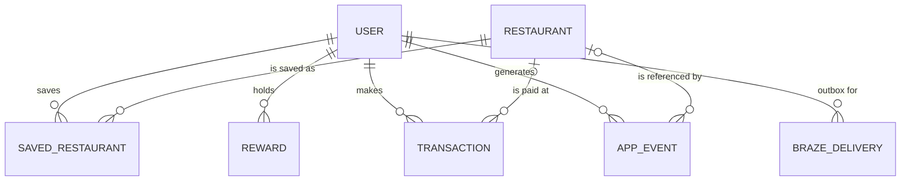
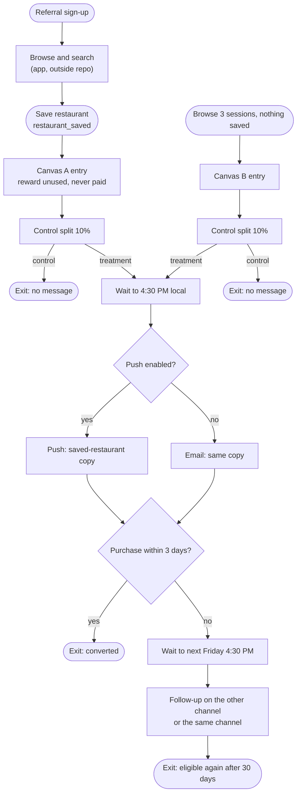

# Journey spec: first-reward nudge

The current design of the journey, as the repo implements it and as the Braze configuration is described. Where the repo cannot verify a rule, the rule is marked **Designed** and points to the gap in [gaps.md](gaps.md).

---

## 1. Problem

A referred user receives a reward (for example, $25 toward a $50+ meal in the app). They may also have saved a restaurant. Nothing reaches them at the point they decide where to eat. The messages they do receive are generic and do not mention the reward or the place they saved.

**Illustrative case.** A person signs up through a referral and saves a restaurant in the first week. They do not buy. Two weeks later, on a weekend evening, they are deciding where to get takeout and open a map app instead. The reward and the saved place were both in their account the whole time.

## 2. Actors and entities

### Actors

| Actor | Goal | Touchpoints in this repo |
|---|---|---|
| Referred new user | Use the reward at a restaurant they want | Push, email (`liquid/messages/`) |
| Operator (growth or operations) | Launch and audit sends safely | Console: `/`, `/users/:id`, `/deliveries`, `/warehouse` |
| Restaurant | Get customers | Catalog entries only; no partner tools in this repo |
| Braze | Holds the profile, runs the Canvases | Configured in the Braze UI |
| Warehouse (Snowflake) | Computes reward and purchase attributes | `sql/`, `rails/app/lib/warehouse/` |

### Entities and relationships

Table names are from `rails/db/schema.rb`.

**Known gap.** A transaction does not link to the reward it used. The link is a boolean (`reward_applied`) and an amount (`reward_amount_cents`). See [gaps.md](gaps.md), G-02.

### Create, change, remove

Each entity states what happens after creation.

| Entity | Created by | Changed by | Removed by | Status |
|---|---|---|---|---|
| User | Seed, warehouse import | Not changed in the app | Not removed | Operator-only |
| Saved restaurant | `POST /users/:id/saved_restaurants` | Not changed | `DELETE /users/:id/saved_restaurants/:id`; writes `restaurant_unsaved` | Built (G-01 closed) |
| Reward | Seed, warehouse | Redeemed on payment (`redeemed_at`) | Not removed | Built |
| Transaction | `POST /users/:id/payments` | Not changed | **No reversal path** | Open (G-02) |
| App event | Model callbacks | Not changed (append-only) | Not removed | Built |
| Braze delivery | Track job | Status only; resend | Not removed | Built |

## 3. Flow

**Canvas A** starts on a save. **Canvas B** starts on sessions, and applies only to users who have not saved anything. Any purchase exits either Canvas. A `restaurant_saved` event moves a Canvas B user into Canvas A.

**Removal.** A removal writes its own event and sends the remaining list. A save removed before its job ran is never sent (the removal covers it). A Canvas already in its delay can still hold the removed restaurant as context; the message no longer names it (section 4). Braze's exit on `restaurant_unsaved` is not configured (G-20).

**Gap.** Nothing in the flow covers a save made late in the week that does not convert before the Friday follow-up. The decision is in [decisions.md](decisions.md), D-02.

## 4. Rules and where they are enforced

Status: **Built** means the repo enforces it and a check covers it. **Designed** means the rule lives in the Braze UI or the warehouse query and the repo cannot run it.

| Rule | Value | Enforced by | Checked by | Status |
|---|---|---|---|---|
| Reward is usable only while unredeemed | `redeemed_at` is null | `rails/app/services/payments/record.rb` | `rails/test/models/txn_test.rb` | Built |
| Payment must meet the reward minimum | subtotal ≥ minimum | `rails/app/models/txn.rb` | `rails/test/models/txn_test.rb` | Built |
| One referral welcome reward per user | partial unique index | `rails/db/schema.rb` | Not asserted by a test | Built; needs confirmation (D-01) |
| Each delivery is stored once | unique `idempotency_key` | `rails/app/models/braze_delivery.rb` | `rails/test/models/braze_delivery_test.rb` | Built |
| Removing a saved restaurant writes `restaurant_unsaved` and sends the remaining list | `SavedRestaurant` `after_destroy`; `Braze::Payloads.restaurant_unsaved` | `rails/test/models/callbacks_test.rb`, `rails/test/lib/braze/payloads_test.rb`, `rails/test/integration/console_test.rb` | Built |
| A removal and its event commit together | `after_destroy` runs inside the destroy transaction | `rails/test/models/callbacks_test.rb` | Built |
| Deleting a user or restaurant sends no unsave | `destroyed_by_association` guard | `rails/test/models/callbacks_test.rb` | Built |
| A queued job for a removed record sends nothing and does not raise | `Braze::TrackJob#locate` | `rails/test/jobs/braze/track_job_test.rb` | Built |
| A removed Canvas context restaurant is not featured | `ik_get_saved_restaurant.liquid` and `03-message.liquid` (same rule) | `liquid/tests/test_messages.py`, `liquid/tests/test_parity.py` | Built |
| Payload is built once and never rebuilt on retry | stored payload | `rails/app/jobs/braze/track_job.rb` | `rails/test/jobs/` | Built |
| Payloads carry no personal fields | no email or name | `rails/app/lib/braze/payloads.rb` | `rails/test/lib/braze/payloads_test.rb` | Built |
| Requests stay under 75 objects | validator limit | `rails/app/lib/braze/validator.rb` | `rails/test/lib/braze/validator_test.rb` | Built (batching not built, G-07) |
| Cloud Data Ingestion view is correct | `UPDATED_AT`, nulls kept | `sql/01_braze_view.sql` | `sql/03_checks.sql` (11 checks) | Built |
| Redeemed reward clears its fields in Braze | `OBJECT_CONSTRUCT_KEEP_NULL` | `sql/01_braze_view.sql` | `sql/03_checks.sql` | Built |
| Message aborts with no unused reward, zero reward, or missing minimum | Liquid abort | `03-message.liquid` | `liquid/tests/test_messages.py` | Built |
| Message never shows an unpriced minimum | minimum always in copy | `03-message.liquid` | `liquid/tests/test_messages.py` | Built |
| Push copy matches the template | parity | `liquid/messages/` | `liquid/tests/test_parity.py` | Built |
| Nearby call is not retried | no `:retry` | `liquid/blocks/logic/ik_get_nearby.liquid` | `liquid/tests/test_messages.py` (fallback case) | Built |
| Send at 4:30 PM local | Delay step | Braze Canvas | Not checked here | Designed (G-08) |
| Follow-up 3 days later, next Friday 4:30 PM | Delay step | Braze Canvas | Not checked here | Designed (G-08) |
| Conversion window 14 days | Braze conversion setting | Braze Canvas | Not checked here | Designed (G-08) |
| Re-entry once every 30 days | Braze entry setting | Braze Canvas | Not checked here | Designed (G-08) |
| 10% control group | Braze split | Braze Canvas | Not checked here | Designed (G-08) |
| Audience: unused reward, never paid | Braze filters | Braze + `sql/02_audience_checks.sql` | Count compared by hand | Designed |

## 5. Screen contract

For each message and screen: what it shows, what the person can do, and where each action leads. The first action in each list is the most prominent.

### Email, saved-restaurant version

Featured only while the profile still lists the restaurant, or when the profile has no list at all. A Canvas context restaurant the profile no longer lists is ignored (decision D-25).

- **Shows:** brand header; reward line with its minimum ("$25 toward a $50+ meal"); saved restaurant as a feature card (name, cuisine, cashback, photo, rating); how-to-use card; footer.
- **Can do:** tap the button; tap the restaurant card; unsubscribe, set preferences, read privacy and terms.
- **Goes to:** the restaurant's page (built from `location_id`) or Explore when there is no page; footer links.

### Email, nearby version

- **Shows:** same header and reward line; up to three nearby restaurants, or the Explore fallback when the call fails or returns none.
- **Can do:** tap a card; tap "Find a spot near you".
- **Goes to:** each restaurant's page; Explore.

### Push, saved-restaurant version

- **Shows:** the offer, the saved restaurant's name, and the question "Dinner tonight?"
- **Can do:** tap the notification.
- **Goes to:** **not defined in this repo.** The deep link is set in Braze's composer. See G-09.

### Console (operator)

- **Shows:** user list (reward state, saves, paid, delivery count); user detail (payments, outbox); warehouse export status and CDI preview.
- **Can do:** record a payment; resend a delivery; export to Snowflake; mark CDI synced.
- **Goes to:** between users, deliveries, warehouse, and background jobs.
- **Scope:** internal. Not part of any demonstration of the customer experience.

### Snippets

- **Restaurant card, compact:** name, cuisine, cashback, thumbnail.
- **Restaurant card, row:** name, cuisine, rating, image.
- **Restaurant card, feature:** name, cuisine, cashback, large image, description.

## 6. Attributes

Status: **V1** is used by the journey now. **Stored** is kept but not used by the journey. **Deferred** is not built and kept for later. **Missing** is needed and not yet defined.

| Attribute | Entity | Type | Source | Status |
|---|---|---|---|---|
| `external_id` | User | string | Rails `users` | V1 |
| `first_reward_amount` | User (Braze) | number | Warehouse view | V1 |
| `first_reward_display` | User (Braze) | string | Warehouse view | V1 |
| `first_reward_min_spend` | User (Braze) | number | Warehouse view | V1 |
| `first_transaction_at` | User (Braze) | time | Warehouse view | V1 |
| `saved_restaurants` | User (Braze) | array of restaurant keys | Rails payload; a removal resends the remaining list | V1 |
| Push and email subscription | User (Braze) | standard | Braze SDK | V1 |
| Total sessions | User (Braze) | number | Braze SDK | V1 (filter name to confirm, D-13) |
| First used app | User (Braze) | time | Braze SDK | V1 |
| Time zone | User (Braze) | string | Braze | **Missing in contract** (G-05) |
| Reward expiry | Reward | time | Not stored | **Missing** |
| Restaurant key, name, cuisine, `location_id` | Restaurant | string | Rails and Catalog | V1 |
| Restaurant rating, cashback, price, description | Restaurant | mixed | Rails and Catalog | Stored |
| Search area | App event | string | None | **Deferred** (G-06) |
| Reward reference on a transaction | Transaction | reference | Not stored | **Missing** (G-02) |
| Transaction status (completed, reversed) | Transaction | string | Not stored | **Missing** (G-02) |

## 7. Out of scope

- inKind app screens: sign-up, sign-in, landing page, and the saved-restaurant action itself.
- Restaurant partner tools and Catalog maintenance.
- Canvas configuration export. The Canvas is documented here in prose and diagram form only.
- Any send. The repo records payloads and does not call Braze in its default mode.
