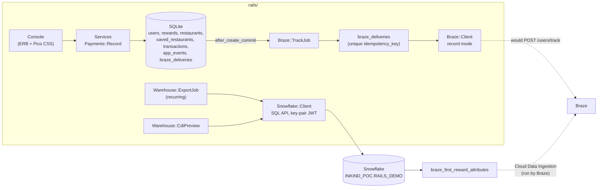

# rails/: architecture

The backend half of the data contract in [`01-data-contract.md`](../01-data-contract.md). The contract names the Rails backend as the owner of the real-time events, `saved_restaurants`, the `restaurants` Catalog, and the rows that reach the warehouse. This app implements that owner against the repo's existing Snowflake proof of concept (`sql/`) and Liquid library (`liquid/`).

Everything here is a sketch built from public documentation. All users, restaurants, and amounts are made up. Not affiliated with inKind.

---

## 1. Scope

**In scope**

- Rails models for the ten sample users in `sql/00_sample_data.sql`, their rewards, saves, views, and payments
- Building the exact Braze `/users/track` payloads from `01` §3, once per action, in an outbox that survives retries
- Exporting new and changed rows to Snowflake through the SQL API, stamped with load time
- Previewing the rows the Cloud Data Ingestion view would hand to Braze on its next sync
- A local console (ERB views) to drive and inspect all of the above
- A bundle for loading the Liquid, the Catalog and test users into a Braze workspace by hand, through the dashboard

**Out of scope**

- Sending to Braze. The available Braze workspace is a trial, which doesn't include the REST API, Cloud Data Ingestion or Data Transformation. So Braze runs in **record mode** only (§6.4). The HTTP adapter exists behind a flag and is covered by WebMock tests, but has never run against a live workspace. Say so wherever it's mentioned
- Auth, mailers, Action Text, deployment. This is a local QA console
- Choosing audiences or sending messages. Braze owns both. Rails decides what's true and records it once

---

## 2. System context



---

## 3. Repo layout

```
rails/
  ARCHITECTURE.md            this file
  README.md                  run instructions and the record-mode label
  app/models/                user, reward, restaurant, saved_restaurant, txn, app_event, braze_delivery, cdi_watermark
  app/services/payments/record.rb
  app/lib/money_format.rb
  app/lib/braze/{payloads,client,validator,invalid_payload}.rb
  app/lib/snowflake/{client,jwt}.rb
  app/lib/warehouse/{export,cdi_preview,statements}.rb
  app/jobs/braze/track_job.rb
  app/jobs/warehouse/export_job.rb
  app/controllers/           users, saved_restaurants, restaurant_views, payments, deliveries, warehouse
  app/views/                 ERB, Pico CSS from the CDN
  config/recurring.yml
  db/migrate/, db/seeds.rb
  test/                      models, lib, jobs, controllers, contract
sql/10_rails_demo_schema.sql
liquid/tools/braze_bundle.py
.github/workflows/rails-tests.yml
```

Name the model `Txn` (table `transactions`) to avoid clashing with `ActiveRecord::Transactions`.

---

## 4. Stack and configuration

| Item | Choice |
|---|---|
| Ruby / Rails | Ruby 3.4 via Mise (pinned in `.ruby-version`), Rails 8.1 |
| Generator | `rails new rails --name=inkind_rails --skip-git --skip-kamal --skip-thruster --skip-docker --skip-action-mailbox --skip-action-mailer --skip-action-text --skip-active-storage --skip-jbuilder --skip-system-test --skip-ci --skip-devcontainer`. Keep the asset pipeline, JavaScript, Hotwire and Solid Queue/Cache/Cable: Solid Queue's installer and Mission Control depend on them. The app can't be named `rails` (it clashes with the framework), hence `--name` |
| `.gitignore` | `--skip-git` also skips `.gitignore`, so `rails/.gitignore` is written by hand with the Rails 8 defaults (`/config/master.key`, `/config/credentials/*.key`, `/db/*.sqlite3*`, `/storage/*`, `/log/*`, `/tmp/*`, `.env*`). Check with `git check-ignore -v rails/config/master.key` before any `git add` |
| Line endings | Repo-root `.gitattributes` with `* text=auto eol=lf`, `rails/.gitattributes` with `bin/* text eol=lf`, and `"files.eol": "\n"` in `.vscode/settings.json`. CRLF in `bin/` breaks the scripts under Linux |
| Database | SQLite (Rails default) |
| Jobs | Solid Queue in **development too**: `config.active_job.queue_adapter = :solid_queue` and `config.solid_queue.connects_to = { database: { writing: :queue } }`, with a `queue` database in the `development` block of `database.yml`. Run jobs inside Puma with `SOLID_QUEUE_IN_PUMA=1 bin/dev`, or on their own with `bin/jobs`. The test environment uses `:test` |
| Job UI | `mission_control-jobs`, mounted at `/admin/jobs`. No login in development (local only); basic auth from credentials anywhere else |
| HTTP | `faraday` |
| JWT | `jwt` (RS256) |
| Tests | Minitest (default), `webmock`, `minitest-mock` (Minitest 6 no longer bundles `stub`) |
| Lint and security | `rubocop-rails-omakase`, `brakeman` (both Rails defaults) |
| Dev setup | One working copy of the repo, edited in VS Code on Windows. Ruby and Rails are installed in WSL2 Ubuntu, and every Rails command runs from WSL against the same folder (`/mnt/c/…/rails`). Don't create other clones. Native Windows Ruby isn't supported for this project |

**Credentials** (`bin/rails credentials:edit`; `config/master.key` stays git-ignored):

```yaml
snowflake:
  account: ORGNAME-ACCOUNTNAME     # uppercased identifier, as in the snow CLI connection
  user: YOUR_USER
  role: SYSADMIN
  warehouse: INKIND_POC_WH
  database: INKIND_POC
  schema: RAILS_DEMO
  private_key_path: /home/you/.snowflake/rsa_key.p8   # never inside the repo
  private_key_passphrase: ""                           # if the key is encrypted
braze:
  mode: record          # the only supported value
mission_control:
  http_basic_auth_user: admin
  http_basic_auth_password: change-me
```

Add `api_key`, `private_key`, and `passphrase` to `config/initializers/filter_parameter_logging.rb`.

---

## 5. Data model

All times are stored in UTC. Money is integer cents; it's converted to `NUMBER(10,2)` only at the warehouse boundary and to dollars only in Braze payloads (§6.1).

| Table | Columns | Indexes and constraints |
|---|---|---|
| `users` | `external_id:string`, `email:string`, timestamps | unique `external_id`. `normalizes :email, with: ->(e) { e.strip.downcase }` |
| `restaurants` | `key:string`, `name`, `location_id`, `cuisine`, `price`, `rating:decimal`, `cashback_pct:integer`, `image_url`, `thumb_url`, `description:text`, timestamps | unique `key` |
| `rewards` | `reward_key:string`, `user:references`, `reward_type:string`, `amount_cents:integer`, `min_spend_cents:integer` (nullable), `redeemed_at:datetime`, `exported_at:datetime`, timestamps | unique `reward_key`. One `referral_welcome` per user |
| `saved_restaurants` | `user:references`, `restaurant:references`, timestamps | unique `[user_id, restaurant_id]` |
| `transactions` (`Txn`) | `transaction_key:string`, `user:references`, `restaurant:references` (nullable: imported history has none; app payments require one), `subtotal_cents:integer`, `tip_cents:integer` (default 0), `reward_applied:boolean`, `reward_amount_cents:integer` (set only when a reward applies; the purchase payload reads it), `exported_at:datetime`, timestamps | unique `transaction_key` |
| `app_events` | `user:references`, `event_name:string`, `restaurant:references` (nullable), `occurred_at:datetime`, `exported_at:datetime` | index `[exported_at]` |
| `braze_deliveries` | `idempotency_key:string`, `user:references`, `endpoint:string`, `payload:json`, `status:string` (`pending`, `recorded`, `failed`), `attempts:integer` (default 0), `last_error:text`, `recorded_at:datetime`, timestamps | **unique `idempotency_key`** |
| `cdi_watermarks` | `view_name:string`, `synced_through:datetime` | unique `view_name` |

**Validations**

- `Txn`: `subtotal_cents > 0`. Custom `validate :reward_is_usable`, which runs when `reward_applied`:
  - the user has an unredeemed `referral_welcome` reward
  - the reward has a `min_spend_cents` (u_1008's missing minimum is a data problem, so refuse it)
  - `subtotal_cents >= min_spend_cents` (u_1004's $38 meal)
  - Errors go on `:base` with readable messages (the course's pattern)
- `Txn` with `on: :app_payment`: the restaurant is required. `Payments::Record` (B6) saves with that context. Imported history (§5.1) saves without it
- `SavedRestaurant`: uniqueness of the pair

### 5.1 Seeds

`db/seeds.rb` mirrors `sql/00_sample_data.sql` exactly: the same ten users, rewards (`rw_01`…), transactions (`tx_01`…), and `restaurant_saved` events. Everything seeded is marked `exported_at: Time.current`, so the exporter only ever sends new activity. Seeds must be idempotent (`find_or_create_by!`). sql/00 has no `session_start` events: sessions are collected by the Braze SDK, not this app, so the seeds omit them. Transactions have no restaurant, as in sql/00. Once the callbacks land (B6), saves and app events will be written with `insert_all`, which skips callbacks, so seeding enqueues no jobs (tested).

Restaurants: the SQL saves reference `r_201`, `r_214`, `r_233`, `r_208` and `r_219`, and the Liquid fixtures use `r_101`. Seed six restaurants so all of them resolve, copying the fields from `liquid/tests/fixtures.py` where they exist:

| key | name | location_id | image (repo-relative) |
|---|---|---|---|
| `r_101` | Lantern Row | demo-101 | `liquid/images/samples/lantern-row.jpg` |
| `r_201` | Nonna Pia's Kitchen | demo-201 | `nonna-pias.jpg` |
| `r_214` | Ember & Oak | demo-202 | `ember-and-oak.jpg` |
| `r_233` | Tidepool Taqueria | demo-203 | `tidepool.jpg` |
| `r_208` | Harbor Noodle House | demo-208 | none |
| `r_219` | Saffron & Salt | demo-219 | none |

`image_url` and `thumb_url` are built from `ASSET_BASE_URL` (default `https://raw.githubusercontent.com/arndvs/inkind-first-reward-journey/main/liquid/images/samples/`). These are the repo's own AI-generated sample images. Never link anyone else's images. `r_208` and `r_219` have no photo, so their `image_url` and `thumb_url` stay nil; the cards already handle that. Emails use `user+<external_id>@example.com`.

---

## 6. Components

### 6.1 `MoneyFormat`

- `dollars(cents)` → `BigDecimal` with 2 places, for Braze `price` and the warehouse
- `display(cents)` → `"25"` for whole dollars, `"12.50"` otherwise. It must match `first_reward_display` in `01` §4 and the Liquid fixtures
- Braze payloads use `MoneyFormat.number(cents)`: an Integer for whole dollars (`38`), a Float otherwise (`62.4`). `BigDecimal` would serialize as a JSON string, and Braze expects numbers

### 6.2 `Braze::Payloads`

Pure functions returning hashes with string keys. Times are `iso8601` UTC with a `Z` suffix and second precision.

```ruby
Braze::Payloads.restaurant_saved(saved_restaurant)
# => {"attributes"=>[{"external_id"=>"u_1001","saved_restaurants"=>["r_201","r_214"]}],
#     "events"=>[{"external_id"=>"u_1001","name"=>"restaurant_saved","time"=>"…Z",
#                 "properties"=>{"restaurant_id"=>"r_214","cuisine"=>"Steakhouse, wood-fired grill"}}]}

Braze::Payloads.restaurant_viewed(app_event)
# => {"events"=>[{"external_id"=>…,"name"=>"restaurant_viewed","time"=>…,"properties"=>{"restaurant_id"=>…}}]}

Braze::Payloads.purchase(txn)
# => {"purchases"=>[{"external_id"=>…,"product_id"=>"dine_in","currency"=>"USD","price"=>62.4,"time"=>…,
#       "properties"=>{"restaurant_id"=>"r_101","subtotal"=>62.4,"tip"=>12.0,
#                      "reward_applied"=>true,"reward_amount"=>25}}]}
```

- `saved_restaurants` is the user's restaurant keys ordered by `saved_restaurants.created_at`
- `reward_amount` is present only when `reward_applied` is true
- `restaurant_id` is present only when the payment has a restaurant. Imported history has none
- `price` equals `subtotal` (food and beverage, the amount the reward rule uses). The tip is a separate property
- Payloads never contain email, name, or other personal fields

### 6.3 `Braze::Validator`

Raises `Braze::InvalidPayload` with a readable message when:

- any object lacks `external_id`
- `attributes`, `events` or `purchases` holds more than 75 objects
- an event lacks `name` or `time`, or a purchase lacks `product_id`, `currency`, `price` or `time`
- `time` doesn't parse as ISO 8601

### 6.4 `Braze::Client`

```ruby
Braze::Client.new(mode: Rails.application.credentials.dig(:braze, :mode) || "record")
  .track(payload)  # => {"message"=>"recorded"} in record mode
```

- **Record mode** (the only supported mode): validates and returns `{"message" => "recorded"}`. No network
- **HTTP adapter** (`mode: "http"`, unverified): `POST #{endpoint}/users/track`, `Authorization: Bearer <key>`, JSON body
- 429 or 5xx raises `Braze::RetryableError`
- other 4xx raises `Braze::PermanentError`
- 201 with an `errors` array is stored as a partial success
- It exists so the shape is tested with WebMock. The README must say it hasn't run against a live workspace

### 6.5 Outbox and `Braze::TrackJob`

```ruby
class Braze::TrackJob < ApplicationJob
  queue_as :braze
  retry_on Braze::RetryableError, wait: :polynomially_longer, attempts: 5
  discard_on Braze::PermanentError, Braze::InvalidPayload   # marks the delivery failed first

  def perform(kind, record_gid)
    record   = GlobalID::Locator.locate(record_gid)
    delivery = BrazeDelivery.create_or_find_by!(idempotency_key: "#{kind}:#{record.to_param}") do |d|
      d.user = record.user
      d.endpoint = "/users/track"
      d.payload = Braze::Payloads.public_send(kind, record)
    end
    return if delivery.recorded?
    delivery.increment!(:attempts)
    response = Braze::Client.new.track(delivery.payload)
    delivery.update!(status: "recorded", recorded_at: Time.current, last_error: nil)
  end
end
```

- The payload is built **once**, when the delivery row is created. Retries resend the stored payload; they never rebuild it from changed data
- Idempotency keys: `restaurant_saved:<saved_restaurant.id>`, `restaurant_viewed:<app_event.id>`, `purchase:<transaction_key>`
- Running the job twice for the same record leaves one delivery and makes one client call

### 6.6 Callbacks and the payment service

- `SavedRestaurant` `after_create_commit`: create an `AppEvent(event_name: "restaurant_saved")`, then enqueue `Braze::TrackJob("restaurant_saved", to_global_id.to_s)`
- `AppEvent` for views: the controller creates it, and `after_create_commit` enqueues `restaurant_viewed` only for `event_name == "restaurant_viewed"`
- `Payments::Record.call(user:, restaurant:, subtotal_cents:, tip_cents:, use_reward:)` wraps the transaction:
  - creates the `Txn` (the validations run)
  - sets `reward.redeemed_at` when the reward applies
  - all inside one `ActiveRecord::Base.transaction`
- `Txn` `after_create_commit` enqueues `purchase`. Because it's after commit, Braze never hears about a payment that rolled back

### 6.7 `Snowflake::Client`

```ruby
Snowflake::Client.new.query("SELECT … WHERE UPDATED_AT > ?::TIMESTAMP_NTZ", ["2026-11-02T00:00:00"])
# => [{"EXTERNAL_ID"=>"u_1001", "UPDATED_AT"=>…, "PAYLOAD"=>"{…}"}]
```

- `POST https://<account>.snowflakecomputing.com/api/v2/statements`
- Headers: `Authorization: Bearer <jwt>`, `X-Snowflake-Authorization-Token-Type: KEYPAIR_JWT`, `Content-Type` and `Accept: application/json`
- Body: `statement`, `timeout: 60`, `warehouse`, `database`, `schema`, `role`, and `bindings` as `{"1"=>{"type"=>"TEXT","value"=>"…"}, …}`
- **Bind every value as TEXT and cast in SQL** (`?::NUMBER(10,2)`, `?::TIMESTAMP_NTZ`, `?::BOOLEAN`). That avoids binding-type surprises
- 200 → map `data` rows onto `resultSetMetaData.rowType[].name`
- 202 → poll `GET /api/v2/statements/{statementHandle}` every second, for up to 30 seconds
- 4xx/5xx → `Snowflake::Error` with Snowflake's `message` and `code`
- `Snowflake::Jwt.token`, RS256:
  - `iss = "#{ACCOUNT}.#{USER}.SHA256:#{fingerprint}"`, `sub = "#{ACCOUNT}.#{USER}"`, `iat = now`, `exp = now + 59.minutes`
  - `ACCOUNT` and `USER` are uppercased
  - `fingerprint = Base64.strict_encode64(OpenSSL::Digest::SHA256.digest(private_key.public_key.to_der))`
  - Cache the token for 50 minutes
  - Follow Snowflake's key-pair JWT documentation if the account format is rejected. That's the usual failure

### 6.8 Warehouse export

`sql/10_rails_demo_schema.sql` (run once, by hand, as SYSADMIN):

```sql
CREATE OR REPLACE SCHEMA INKIND_POC.RAILS_DEMO CLONE INKIND_POC.FIRST_REWARD;
USE SCHEMA INKIND_POC.RAILS_DEMO;
-- then re-create braze_first_reward_attributes with the statement from 01_braze_view.sql
```

The clone keeps `FIRST_REWARD` untouched, so `sql/03_checks.sql` still passes there.

`Warehouse::ExportJob` (recurring every 10 minutes in development; a console button enqueues it on demand):

1. Exit without calling Snowflake when nothing has `exported_at: nil`. That keeps the warehouse asleep
2. `transactions`: one multi-row `INSERT … VALUES (?, ?, ?::NUMBER(10,2), ?::BOOLEAN, ?::TIMESTAMP_NTZ, CURRENT_TIMESTAMP()), …`, at most 100 rows per statement. `amount` is the subtotal
3. `app_events`: `INSERT … (user_id, event_name, restaurant_id, event_at)` the same way
4. `rewards` (new or redeemed since the last export):

```sql
MERGE INTO rewards t
USING (
  SELECT ? AS reward_id, ? AS user_id, ? AS reward_type, ?::NUMBER(10,2) AS amount,
         ?::NUMBER(10,2) AS min_spend, ?::TIMESTAMP_NTZ AS redeemed_at
) s
ON t.reward_id = s.reward_id
WHEN MATCHED THEN UPDATE SET t.redeemed_at = s.redeemed_at, t.updated_at = CURRENT_TIMESTAMP()
WHEN NOT MATCHED THEN INSERT (reward_id, user_id, reward_type, amount, min_spend, redeemed_at, updated_at)
  VALUES (s.reward_id, s.user_id, s.reward_type, s.amount, s.min_spend, s.redeemed_at, CURRENT_TIMESTAMP());
```

5. Set `exported_at` on each Rails row **only after** its statement succeeds
6. `updated_at` and `loaded_at` are the load time (`CURRENT_TIMESTAMP()`), so a late row still moves the view's `UPDATED_AT`

### 6.9 `Warehouse::CdiPreview`

- `rows` runs `SELECT EXTERNAL_ID, UPDATED_AT, PAYLOAD FROM braze_first_reward_attributes WHERE UPDATED_AT > ?::TIMESTAMP_NTZ ORDER BY UPDATED_AT` with the stored watermark (default: epoch). `PAYLOAD` is `JSON.parse`d
- `mark_synced!` sets the watermark to the newest `UPDATED_AT` shown
- The UI labels it: "Rows Braze Cloud Data Ingestion would pick up on its next sync. Braze runs the real sync; this page only previews it."

---

## 7. Console

Pico CSS from the CDN. Routes:

| Route | Shows or does |
|---|---|
| `GET /` | Users table: external ID, reward (amount, unused or used), saved count, paid yes/no, deliveries count |
| `GET /users/:id` | The user's state; forms for Save restaurant (select), View restaurant (select), Pay (restaurant, subtotal, tip, "use reward"); outbox entries as pretty JSON, newest first; validation errors on `:base` at the top |
| `POST /users/:user_id/saved_restaurants` | Create the save |
| `POST /users/:user_id/restaurant_views` | Create the `restaurant_viewed` event |
| `POST /users/:user_id/payments` | `Payments::Record` |
| `GET /deliveries` | All deliveries: key, status, attempts, user, created and recorded times. Click for the JSON |
| `GET /warehouse` | Counts not yet exported; "Run export now" (`POST /warehouse/export`); last run result |
| `GET /warehouse/cdi_preview` | The preview table and a "Mark synced" button (`POST /warehouse/cdi_preview/mark_synced`) |
| `/admin/jobs` | Mission Control Jobs |
| `GET /users/:id/timeline.json` | The user's state, deliveries and app events as JSON, for an optional Next.js page |

Use strong params with `params.expect`. Errors render with `status: :unprocessable_content`. Flash notices on success.

---

## 8. Braze workspace bundle (`liquid/tools/braze_bundle.py`)

A trial workspace has no REST API, but its dashboard can create Content Blocks, create a Catalog from a CSV, import users from a CSV, and preview an email as a user. The script writes everything needed for those manual steps to `liquid/build/braze-bundle/` (git-ignored):

| File | Use |
|---|---|
| `blocks/01_ik_brand.liquid` … `NN_<block>.liquid` | Every file in `liquid/blocks/`, numbered in dependency order (config, logic, layout, elements, components, sections). `../images/` is rewritten to `ASSET_BASE_URL` (default: the repo's raw GitHub URL for `liquid/images/`). The Content Block name is the file name without the number |
| `email_body.liquid` | `messages/first_reward.email.liquid`, with the same rewrite |
| `restaurants_catalog.csv` | Catalog `restaurants`. First column `id`, then `name, location_id, cuisine, price, rating, cashback_pct, image_url, thumb_url, description`. Four rows from §5.1, with absolute image URLs. Quote every string |
| `users_import.csv` | Columns `external_id, first_reward_amount, first_reward_display, first_reward_min_spend, first_transaction_at`, one row per sample user, with the values `braze_first_reward_attributes` would produce for `sql/00` (a redeemed reward gives blanks; `first_transaction_at` is ISO 8601 or blank). Add `u_9001`, a zero-amount reward. **No `saved_restaurants` column**: Braze's CSV import doesn't support arrays. No emails |
| `PREVIEW_CASES.md` | Per user: what the email preview should show (see below) |
| `CHECKLIST.md` | The manual steps in order, with the "names can't be changed after launch" warning for Content Blocks and the Catalog |

**Expected preview results** (`PREVIEW_CASES.md`):

| User | Expected |
|---|---|
| u_1001 | "$25 toward a $50+ meal". With no saved restaurant on the profile and no live recommendations endpoint: the Explore fallback |
| u_1003 | "$12.50". If it shows "$12.5", the CSV import typed `first_reward_display` as a number. Record that as a finding (the warehouse path sends it as a JSON string) |
| u_1002 | Abort: no unused reward |
| u_1005 | Abort: no unused reward |
| u_1008 | Abort: reward minimum missing |
| u_9001 | Abort: reward amount is zero |
| Saved-restaurant card | Needs `saved_restaurants` or Canvas context, which CSV import can't set. Try "Preview as → Custom user" with `saved_restaurants = ["r_101"]`. If the preview won't take an array, the card can't be rendered in this workspace. Note that in the checklist rather than changing the message |

Add a test asserting: the bundle covers every block; no file contains `../images/`; the catalog CSV has an `id` first column and four rows; the users CSV values match the view's rules (whole dollars → `"25"`, redeemed → blank).

---

## 9. Testing

All HTTP goes through WebMock. CI never needs Snowflake or Braze credentials.

| Area | Tests |
|---|---|
| Models | Each validation, including u_1004 (under the minimum) and u_1008 (minimum missing); `normalizes :email`; save uniqueness |
| `MoneyFormat` | `2500` → `"25"`, `1250` → `"12.50"`, `6240` → `62.4` |
| **Contract** | Parse every ` ```json ` block under `## 3.` in `../01-data-contract.md`. Build the same payloads from fixtures with `external_id: "u_123"`, `restaurant_id: "r_456"` and the sample times, and assert deep equality. The doc and the code can't drift |
| Validator | Rejects 76 events, a missing `external_id`, a bad `time` |
| Track job | `assert_enqueued_jobs 1` after each create; `perform_enqueued_jobs` twice leaves one delivery; a retryable error retries; a permanent error marks the delivery `failed`; the stored payload doesn't change after its source record is edited |
| Payments | A rollback creates no delivery; the reward is redeemed only when applied |
| HTTP adapter | WebMock asserts URL, headers and body; 429 maps to retryable |
| Snowflake | JWT claims shape (with a generated test key); request body and TEXT bindings; 202 then 200 polling; `exported_at` set only after success; no request when nothing is pending |
| CDI preview | Parses `PAYLOAD`; the watermark advances |
| Controllers | Each POST: the happy path, and errors rendered with 422 |

**CI**: `.github/workflows/rails-tests.yml`

- Triggers on pushes and PRs touching `rails/**`, `01-data-contract.md` or the workflow itself
- `runs-on: ubuntu-24.04`, `actions/checkout@v5`, `ruby/setup-ruby@v1` (`working-directory: rails`, `bundler-cache: true`)
- Then `bin/rails db:prepare test`, `bin/brakeman --no-pager`, `bin/rubocop`

---

## 10. Implementation tasks

One commit per task, on `feature/rails-backend`. Each must leave `bin/rails test` green.

**Status:** task 11 is done and merged to `main` (its own branch). Tasks 1–4 are done on `feature/rails-backend`: the app skeleton plus `PingJob` (verified finished in Mission Control), the models and validations, the seeds, and the Braze payloads, validator, `MoneyFormat` and contract test. Next is task 5, `Braze::Client`.

| # | Task | Done when |
|---|---|---|
| 1 | Generate the app (§4), add the gems, Pico CSS, Solid Queue in development, Mission Control at `/admin/jobs` | `bin/dev` and `bin/jobs` run; `/admin/jobs` loads behind basic auth |
| 2 | Migrations and models (§5), with validations and tests | Model tests pass, including u_1004 and u_1008 |
| 3 | Seeds (§5.1) and `MoneyFormat` | `db:seed` twice gives the same counts; the format tests pass |
| 4 | `Braze::Payloads`, `Braze::Validator`, and the contract test. Update the purchase sample in `01-data-contract.md` §3 to include `restaurant_id`, `subtotal` and `tip` in the **same commit** | The contract test passes against the edited doc |
| 5 | `Braze::Client` (record mode, plus the HTTP adapter with WebMock tests) | Client tests pass |
| 6 | `BrazeDelivery`, `Braze::TrackJob`, callbacks, `Payments::Record` | Job and payment tests pass, including run-twice and rollback |
| 7 | Console: users index and show, the three POSTs, deliveries | Save and pay in the browser each produce exactly one delivery with the right JSON |
| 8 | `Snowflake::Jwt` and `Snowflake::Client` | WebMock tests pass. A manual `bin/rails runner 'p Snowflake::Client.new.query("SELECT CURRENT_VERSION()")'` returns a version |
| 9 | `sql/10_rails_demo_schema.sql`, `Warehouse::ExportJob`, `config/recurring.yml`, the warehouse page | Paying as u_1001 then exporting adds a `transactions` row with a fresh `loaded_at` in `RAILS_DEMO`, and `rw_01.redeemed_at` is set |
| 10 | `Warehouse::CdiPreview` and its page | After task 9, u_1001's row shows `first_reward_amount: null` and a later `UPDATED_AT`. `03_checks.sql` against `FIRST_REWARD` is still 11/11 |
| 11 | `liquid/tools/braze_bundle.py`, its test, and the `.gitignore` entry (§8). **Do this task first**: it doesn't depend on the Rails app | The bundle tests pass, and both CSVs open cleanly in a spreadsheet |
| 12 | `rails/README.md`, the root README row, and the CI workflow | CI is green on the branch |

**Root README row:** `rails/`, the backend half of the data contract. It builds the `/users/track` events in `01` once per action (recorded, not sent), exports rows to Snowflake with their load time, and previews what Cloud Data Ingestion would sync.

**`rails/README.md` must include:**

- How to run it: WSL, `bin/setup`, `bin/dev`, `bin/jobs`, the credentials keys, `sql/10_rails_demo_schema.sql`
- The record-mode statement from §1
- That all data is fictional

---

## 11. Rules for the branch

- Fictional data only: the ten sample users, `demo-` location IDs, `example.com` emails, and the repo's own sample images
- Never commit `config/master.key`, a private key, `.env`, or the `liquid/build/` folder. Before every commit that adds files under `rails/`, run `git check-ignore -v rails/config/master.key`
- Keep `config/master.key` backed up outside the repo. Without it, the encrypted credentials can't be read
- Files are committed with LF line endings
- Commit messages describe the code change only, in plain imperative English, with no trailers
- Don't change `sql/00`–`03` or their expected results. The Rails demo works only in `RAILS_DEMO`
- Don't change any Liquid block's output. The Liquid tests and the parity test must stay green
- If a Snowflake or Braze detail in this document disagrees with the vendor's current documentation, follow the documentation and note the change in the commit message
